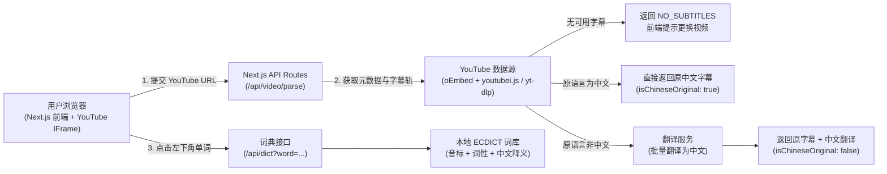

# YouTube 英语学习网站技术方案设计（基于方案 A）

> **文档说明**：本文档基于已定稿的 [product_design.md](file:///e:/cursor_folders/youtube_subtitle_2/product_design.md)（方案 A：轻量纯粹型「即贴即学」极简精听工具）进行技术架构与模块设计，覆盖技术选型、系统架构、核心模块实现方案、接口定义与关键边界处理。

---

## 一、总体技术选型

结合方案 A「无账号、无复杂数据库、快速落地、全栈一体」的特点，推荐采用 **全栈 TypeScript（Next.js App Router）** 单体仓库架构：

| 层级 | 推荐选型 | 选型理由 |
| :--- | :--- | :--- |
| **前端框架** | **Next.js 15 (App Router) + React + TypeScript** | 前后端一体化，无需单独维护后端服务；类型安全，开发与部署成本最低。 |
| **UI 与样式** | **Tailwind CSS** | 便于快速还原 `example.jpg` 的纸感浅米色主题、双栏自适应布局与 `certain_word.jpg` 的词卡细节。 |
| **视频播放** | **YouTube IFrame Player API** | 官方标准嵌入方案，支持精确时间戳跳转（`seekTo`）、倍速调节、实时播放进度读取与状态监听。 |
| **字幕提取** | **服务端提取（`youtubei.js` 或 `yt-dlp`）** | 浏览器直接请求 YouTube 字幕存在跨域（CORS）与风控限制，必须由服务端代理获取并解析。 |
| **字幕翻译** | **大模型 / 翻译 API 批量翻译 + 服务端缓存** | 仅在非中文原声视频时触发；按批次（如每 20~30 句）带上下文翻译，译文比机翻更自然。 |
| **英汉词典** | **本地开源词库 ECDICT（JSON/SQLite）+ Web Speech API** | 离线零延迟返回音标与中文简明释义，自带词形还原（如 `trapped -> trap`）；发音优先调用词典音频或浏览器原生 TTS。 |
| **数据存储** | **浏览器 `localStorage` + 服务端轻量缓存（内存/文件）** | 方案 A 无需用户系统，`localStorage` 保存最近观看记录；服务端按 `videoId` 缓存已解析/翻译的字幕，避免重复耗时。 |

---

## 二、系统架构与核心数据流



---

## 三、核心模块技术设计

### 1. YouTube 链接解析与视频信息获取
- **URL 兼容解析**：支持解析以下常见 YouTube 链接格式，提取 11 位 `videoId`：
  - `https://www.youtube.com/watch?v=VIDEO_ID`
  - `https://youtu.be/VIDEO_ID`
  - `https://www.youtube.com/shorts/VIDEO_ID`
  - `https://www.youtube.com/embed/VIDEO_ID`
- **保持原视频长宽比**：
  - 调用 YouTube 官方免鉴权接口 `https://www.youtube.com/oembed?url=https://www.youtube.com/watch?v={videoId}&format=json`，获取视频真实 `width`、`height` 与 `title`。
  - 前端播放器外层容器通过 CSS `aspect-ratio: width / height` 动态约束尺寸，确保无论是 16:9 横屏、4:3 老视频（如 `example.jpg` 中的乔布斯演讲）还是 9:16 竖屏视频，均**严格保持原长宽比不变**，左侧下方自然留白展示当前句卡片。

### 2. 字幕提取、语言判断与翻译策略（服务端）
在 `/api/video/parse` 中执行以下流水线：

1. **提取可用字幕轨**：
   - 优先获取人工上传的原始字幕（Manual Captions）；若无人工字幕，再检查是否有自动生成字幕（Auto-generated Captions）。
   - **无字幕拦截**：若两者均不存在，直接返回 `{ code: "NO_SUBTITLES", message: "该视频暂无可用字幕，请更换视频" }`，前端直接展示该提示，不跳转学习页。
2. **判断是否为中文原声视频**：
   - 检查主字幕轨语言代码（如 `zh`、`zh-CN`、`zh-Hans`、`zh-TW`、`zh-Hant`）。
   - **若为中文**：设置 `isChineseOriginal = true`，不调用翻译服务，每条字幕的 `translation` 字段留空。
   - **若为非中文**（如 `en`、`en-US` 等）：设置 `isChineseOriginal = false`，进入翻译流程。
3. **字幕清洗与批量翻译**：
   - **时间轴合并与断句优化**：YouTube 字幕有时一句被拆成多条短片段，可按标点符号（`.`、`?`、`!`）或时间间隔适当合并/对齐，保证阅读连贯性。
   - **批量翻译**：将原字幕按 `index` 打包（如每批 25 句）发送至翻译接口（LLM API 或传统机器翻译 API），要求按原 `index` 一一对应返回中文翻译，确保英文与中文严格逐条对齐。
   - **结果缓存**：将 `{ meta, isChineseOriginal, subtitles }` 以 `videoId` 为键缓存在服务端内存或本地 JSON 文件中，二次访问同一视频实现秒开。

### 3. 播放器与字幕双向联动（前端）
- **实时同步（视频 -> 字幕）**：
  - 当 YouTube IFrame Player 处于 `PLAYING` 状态时，前端启动一个 `100ms` 轮询定时器（或 `requestAnimationFrame` 节流）读取 `player.getCurrentTime()`。
  - 使用**二分查找**在有序字幕数组中定位满足 `start <= currentTime < end` 的当前句索引 `activeIndex`。
  - 仅当 `activeIndex` 发生变化时更新 React 状态，避免高频重渲染：
    - 更新左侧下方「当前句卡片」内容。
    - 高亮右侧对应字幕条目；若未处于用户手动滚动浏览状态，调用 `element.scrollIntoView({ behavior: 'smooth', block: 'center' })` 自动居中。
- **点击跳转（字幕 -> 视频）**：
  - 点击右侧任意一条字幕，调用 `player.seekTo(subtitle.start, true)`，若视频处于暂停态则同时调用 `player.playVideo()`。
- **单句循环控制**：
  - 开启「单句循环」时，在同步检测中若发现 `currentTime >= activeSubtitle.end`，立即调用 `player.seekTo(activeSubtitle.start, true)` 回到该句开头。

### 4. 当前句分词与点词翻译（`certain_word.jpg` 交互实现）
- **句子分词渲染**：
  - 前端使用正则将当前句英文按「单词 / 空白与标点」切分为 Token 数组（例如保留 `Don't`、`else's` 等常见缩略词完整，同时提取纯字母词根用于查词）。
  - 单词 Token 绑定点击事件；被点击的单词记录为 `selectedWord`，渲染高亮背景色与底部蓝色下划线（还原 `certain_word.jpg` 样式）。
- **不暂停视频的联动逻辑**：
  - 点击单词触发 `/api/dict?word={cleanWord}` 请求，**不调用 `player.pauseVideo()`**，视频继续正常播放。
  - 当视频自然播放进入下一句（`activeIndex` 变化）时：
    - 当前句文本切换为新句子，旧句的 `selectedWord` 高亮清除；
    - 弹出词卡可跟随关闭，或保留至用户点击 `×` 关闭（推荐：切换句子时自动收起旧词卡，保持左下角区域整洁；也可在弹窗未关闭前允许用户手动点击 `×`）。
- **词典查询与词形还原（`/api/dict`）**：
  - 基于 **ECDICT** 开源英汉词库构建轻量查询服务：
    - 精确匹配单词；若未命中或为屈折变化词（如 `trapped`、`living`、`opinions`），通过词形还原规则或 ECDICT 自带的 `exchange` 变形映射字段定位原型词（如 `trap`、`live`、`opinion`），返回原型词的音标（IPA）与简明中文释义（如 `v. 困住；诱捕`）。
  - **发音朗读**：点击词卡喇叭图标时，优先播放词典音频（若有），降级使用浏览器原生 `window.speechSynthesis`（`lang = 'en-US'`）朗读该单词，零外部依赖。

---

## 四、核心数据结构与接口定义

### 1. 前端核心数据类型（TypeScript）

```ts
export interface SubtitleItem {
  index: number;        // 字幕序号（从 1 开始）
  start: number;        // 起始时间（秒，如 741.2）
  end: number;          // 结束时间（秒）
  text: string;         // 原字幕文本
  translation?: string; // 中文翻译（中文原声视频为 undefined）
}

export interface VideoLearningData {
  videoId: string;
  title: string;
  aspectRatio: number;        // 宽高比，如 16/9 或 4/3
  isChineseOriginal: boolean; // true 表示中文原声，不显示翻译
  subtitles: SubtitleItem[];
}

export interface WordLookupResult {
  word: string;        // 查询的单词
  lemma?: string;      // 还原后的原型词（如有）
  phonetic: string;    // 音标，如 /'dɑgmə/
  meaning: string;     // 简明释义，如 "n. 教条"
}
```

### 2. 服务端 API 接口

| 接口路径 | 方法 | 请求参数 | 返回说明 |
| :--- | :--- | :--- | :--- |
| `/api/video/parse` | `POST` | `{ url: string }` | 解析 YouTube 链接，返回 `VideoLearningData`；若无字幕返回 `404` 及 `"该视频暂无可用字幕，请更换视频"`。 |
| `/api/dict` | `GET` | `?word=dogma` | 返回 `WordLookupResult`（音标 + 简明中文释义）；未收录单词返回 `404` 友好提示。 |

---

## 五、页面状态与关键边界处理

1. **首页最近记录（`localStorage`）**：
   - Key：`yt_learn_recent_videos`
   - 存储最近 5 条学习过的 `{ videoId, title, thumbnail, updatedAt }`，点击即可直接进入 `/learn/[videoId]`。
2. **滚动冲突处理**：
   - 监听右侧字幕容器的 `onWheel` / `onTouchMove` 事件：一旦用户主动上下翻看字幕，暂时标记 `isUserScrolling = true` 并显示悬浮按钮「回到当前句」；点击按钮或 5 秒无操作后恢复自动跟随。
3. **YouTube 网络与异常兜底**：
   - 若用户所在网络环境无法加载 YouTube IFrame 播放器，播放器区域展示友好的网络连接提示。
   - 若翻译接口单批超时，支持局部重试而不阻塞整个视频加载。

---

## 六、推荐目录结构（Next.js App Router）

```text
src/
├── app/
│   ├── page.tsx                  # 极简首页（URL 输入 + 本地最近记录）
│   ├── learn/[videoId]/page.tsx  # 双栏精听学习页
│   └── api/
│       ├── video/parse/route.ts  # 字幕提取、语言判断与批量翻译接口
│       └── dict/route.ts         # 本地 ECDICT 点词翻译接口
├── components/
│   ├── YouTubePlayer.tsx         # 封装 YouTube IFrame API 与等比例容器
│   ├── CurrentSubtitleCard.tsx   # 左下角当前句展示 + 单词点击 + 词卡弹窗
│   ├── SubtitleList.tsx          # 右侧可滚动字幕列表 + 点击跳转 + 回到当前句
│   └── PlaybackControls.tsx      # 右侧底部播控条（上下句、倍速、单句循环）
├── lib/
│   ├── youtube.ts                # videoId 解析、oEmbed 比例与字幕抓取封装
│   ├── translator.ts             # 批量字幕翻译与缓存封装
│   └── dict.ts                   # ECDICT 词库加载与词形还原查询
└── types/
    └── index.ts                  # 全局 TypeScript 类型定义
```
